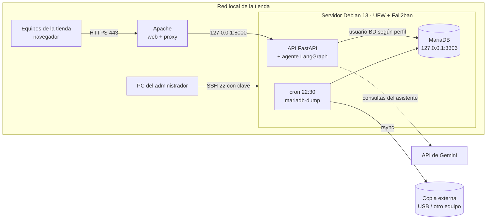

# Infraestructura Linux para la gestión de una tienda de alimentación

Proyecto Intermodular · CFGS Administración de Sistemas Informáticos en Red · Curso 2026-2027
Autor: **Linmao Xia** · Tutora: Simona Ionescu

Este proyecto monta un servidor **Debian 13** con **MariaDB** para una tienda de alimentación familiar. Sustituye la libreta en la que se apuntaba la facturación por un sistema que:

- **Actualiza el stock solo** con cada compra, venta o producto tirado, y avisa de lo que hay que pedir.
- **Calcula el beneficio real** (precio sin IVA − coste de compra) por producto, categoría y mes, y lo compara con la estimación del 15 % que se usaba antes.
- **Controla las caducidades por lotes**, sin revisar producto a producto.
- Tiene **dos perfiles**: el administrador lo ve todo; el dependiente vende y consulta stock, pero no ve costes ni beneficios.
- Está **securizado** (SSH con claves, UFW, Fail2ban, HTTPS) y hace **copias de seguridad diarias** con restauración comprobada.
- Incluye una **web moderna** con un **asistente virtual** (LangChain + LangGraph + Gemini) al que se le pregunta en lenguaje natural: _"¿qué caduca esta semana?"_ o _"¿qué productos me dejan menos margen?"_.

## Arquitectura



## Estructura del repositorio

```
sql/                 Base de datos (se ejecuta en este orden)
  01_esquema.sql       tablas y restricciones
  02_triggers.sql      stock, coste medio, lotes y caducidades
  03_vistas.sql        stock, alertas e informes de beneficio
  04_roles.sql         perfiles administrador / dependiente
  05_usuarios.sh       usuarios de MariaDB (contraseñas desde .env)
  06_datos_base.sql    IVA, categorías y proveedores reales
  07_datos_ejemplo.sql datos ficticios para pruebas
scripts/
  servidor/            instalación y securización del servidor (01, 02, 03)
  backup/              copia diaria, rotación, copia externa y restauración
  local/               cargar la BD en un MariaDB de Windows
config/              ficheros de configuración (SSH, Fail2ban, MariaDB, Apache, systemd, red)
app/
  backend/             API en Python (FastAPI) + asistente (LangChain / LangGraph)
  frontend/            web en React + Tailwind
docs/                documentación
docker-compose.yml   entorno completo para probar en local
```

## Documentación

1. [Diseño de la base de datos](docs/01-modelo-datos.md): modelo E-R, modelo relacional, triggers, vistas y permisos.
2. [Guía paso a paso del servidor](docs/02-guia-servidor.md): VirtualBox, Debian 13, securización, MariaDB, copias de seguridad y web.
3. [Probar en local sin máquina virtual](docs/03-probar-en-local.md): con Docker Desktop o con MariaDB en Windows.

## Prueba rápida

```powershell
copy .env.example .env      # y cambia las contraseñas
docker compose up --build
```

Abre http://localhost:8080 y entra con `admin` / `admin1234` o `dependiente` / `tienda1234`.

## Tecnologías

Debian 13 · MariaDB 11.8 · OpenSSH · UFW · Fail2ban · Bash · cron · mariadb-dump · rsync · Apache 2 · Python 3 (FastAPI) · LangChain · LangGraph · Gemini · React · Tailwind CSS · Docker (solo para pruebas) · Git / GitHub.

Todo es software libre, salvo el servicio del modelo de lenguaje del asistente (Google Gemini, con capa gratuita). El asistente es opcional: sin clave de API, el resto del sistema funciona igual.

La web tiene **tema claro y oscuro** (o automático según el sistema), está pensada también para el móvil y lee códigos de barras con un lector USB.
