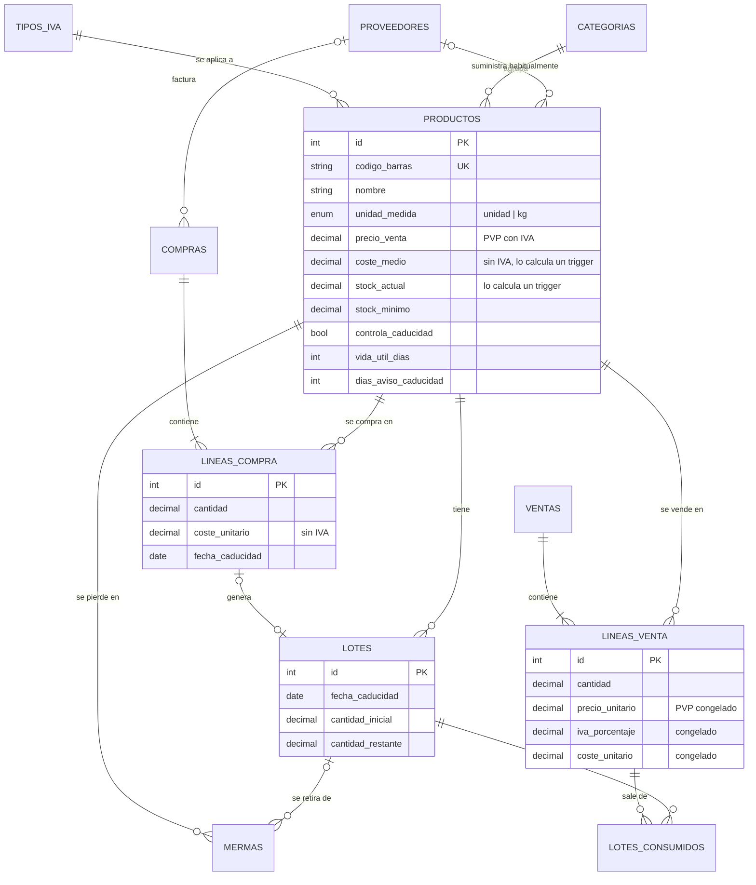

# 1. Diseño de la base de datos

## 1.1 Modelo entidad-relación

> El diagrama se ve directamente en GitHub. Para la memoria se puede redibujar en draw.io.

## 1.2 Modelo relacional

Las claves primarias van **en negrita** y las ajenas en _cursiva_.

- **tipos_iva** (**id**, nombre, porcentaje)
- **categorias** (**id**, nombre, descripcion, activa)
- **proveedores** (**id**, nombre, contacto, telefono, email, notas, activo)
- **productos** (**id**, codigo_barras, nombre, _categoria_id_, _proveedor_id_, _iva_id_, unidad_medida, precio_venta, coste_medio, stock_actual, stock_minimo, controla_caducidad, vida_util_dias, dias_aviso_caducidad, activo, creado_en)
- **compras** (**id**, _proveedor_id_, fecha, numero_factura, total_sin_iva, usuario, notas)
- **lineas_compra** (**id**, _compra_id_, _producto_id_, cantidad, coste_unitario, fecha_caducidad)
- **lotes** (**id**, _producto_id_, _linea_compra_id_, fecha_entrada, fecha_caducidad, cantidad_inicial, cantidad_restante)
- **ventas** (**id**, fecha, metodo_pago, pago_tarjeta, pago_bizum, total, usuario)

  `metodo_pago` puede ser `efectivo`, `tarjeta`, `bizum` o `mixto`. En un pago mixto se guarda lo cobrado con tarjeta y con Bizum, y el efectivo es lo que falta hasta el total: así el reparto siempre suma el total del ticket.
- **lineas_venta** (**id**, _venta_id_, _producto_id_, cantidad, precio_unitario, iva_porcentaje, coste_unitario)
- **mermas** (**id**, _producto_id_, _lote_id_, cantidad, motivo, coste_unitario, fecha, usuario, notas)
- **lotes_consumidos** (**id**, _linea_venta_id_, _lote_id_, cantidad)
- **cierres_caja** (**id**, fecha, tickets, total_efectivo, total_tarjeta, total_bizum, fondo_inicial, efectivo_contado, diferencia, usuario, notas, creado_en)
- **auditoria** (**id**, fecha, usuario, accion, tabla, registro_id, detalle)
- **usuarios_app** (**id**, usuario, nombre, password_hash, rol, activo, creado_en)

`cierres_caja` y `auditoria` no tienen claves ajenas a propósito: son un registro histórico y deben conservarse aunque se borre o cambie lo que describen.

## 1.3 Decisiones de diseño

| Necesidad de la tienda | Cómo se resuelve |
|---|---|
| **Productos a granel** (patatas, cebollas, ajos) | `unidad_medida` = `kg` y todas las cantidades son `DECIMAL(10,3)`: se puede vender 1,250 kg. Un trigger impide vender medias unidades de lo que va por unidades. |
| **Saber el beneficio real** | Cada línea de venta guarda el PVP, el IVA y el coste de compra **de ese momento**. Beneficio = PVP sin IVA − coste. Si mañana cambian los precios, los meses anteriores no cambian. |
| **Coste de compra cambiante** | Se usa el **coste medio ponderado**: cada compra recalcula el coste según lo que había y lo que entra. Es el método habitual en contabilidad de existencias. |
| **IVA aún por confirmar** | Tabla `tipos_iva` aparte. Cada producto apunta a un tipo; si un porcentaje cambia, se cambia en un solo sitio. |
| **Caducidades sin vigilar producto a producto** | Ver 1.4. |
| **Categorías y proveedores nuevos** | Son tablas, no listas fijas: se añaden desde la web (Catálogo) sin tocar la BD. |
| **Datos coherentes** | `CHECK` (cantidades > 0, precios ≥ 0), claves ajenas, y el stock solo lo cambian los triggers. |
| **Equivocarse al cobrar** | La venta se anula entera (solo el administrador). Los triggers devuelven el stock **y la cantidad a sus lotes**, gracias a `lotes_consumidos`, que apunta de qué lote salió cada línea. |
| **Cuadrar la caja** | `cierres_caja` guarda, por día, lo cobrado por cada forma de pago y el efectivo contado. La diferencia es una **columna calculada** (`efectivo_contado − fondo_inicial − total_efectivo`). |
| **Saber quién cambió qué** | Tabla `auditoria`, rellenada por triggers. La web pasa el usuario en la variable de sesión `@usuario_app`; si el cambio se hace a mano en el servidor, se guarda el usuario de MariaDB (`CURRENT_USER()`). |

## 1.4 Control de caducidades automático

La idea es que **nadie tenga que revisar las fechas producto a producto**:

1. Solo los productos que lo necesitan (lácteos, pan, bollería, embutido, sándwiches…) tienen `controla_caducidad = TRUE`. A la ferretería, la limpieza o los juguetes no se les pide nunca la fecha.
2. Al registrar una compra de esos productos se crea un **lote** con su fecha de caducidad. Si el producto tiene `vida_util_dias` (por ejemplo, sándwich = 5 días) y no se escribe fecha, **se calcula sola**: hoy + vida útil.
3. Cada venta **gasta los lotes que caducan antes** (método FEFO, _First Expired, First Out_), igual que se hace en la estantería poniendo delante lo que caduca antes.
4. La vista `v_caducidades` muestra solo los lotes caducados o que caducan en los próximos `dias_aviso_caducidad` días. Es la "lista de la mañana", que aparece en el inicio de la web y se le puede preguntar al asistente.
5. Lo que se tira se registra como **merma** (botón "Retirar"). Así baja el stock y la pérdida aparece en el informe de beneficios.

## 1.5 Triggers

| Trigger | Cuándo | Qué hace |
|---|---|---|
| `trg_lc_before_insert` | Antes de una línea de compra | Calcula la fecha de caducidad con la vida útil, o exige que se indique |
| `trg_lc_after_insert` | Después de una línea de compra | Suma el stock, recalcula el coste medio, crea el lote y suma el total de la compra |
| `trg_lc_before_delete`, `trg_compras_before_delete` | Al borrar una compra o una línea | Deshace el stock y borra los lotes |
| `trg_lv_before_insert` | Antes de una línea de venta | Comprueba que hay stock, que el producto está activo y que no se venden fracciones de unidades. Copia el PVP, el IVA y el coste |
| `trg_lv_after_insert` | Después de una línea de venta | Resta el stock, gasta los lotes (FEFO) y suma el total del ticket |
| `trg_lv_after_delete`, `trg_ventas_before_delete` | Al anular una venta o una línea | Devuelve el stock y corrige el total |
| `trg_lc_before_update`, `trg_lv_before_update` | Al intentar modificar una línea | Lo impide: las líneas se borran y se registran de nuevo, así queda rastro |
| `trg_merma_before_insert`, `trg_merma_after_insert` | Al registrar una merma | Comprueba el stock y el lote, y lo descuenta |
| `trg_lv_before_delete` | Al borrar una línea de venta | Devuelve la cantidad a los lotes de los que salió |
| `trg_merma_auditoria`, `trg_productos_auditoria`, `trg_usuarios_alta`, `trg_usuarios_cambio` | Mermas, cambios de precio o de alta/baja, cambios de usuarios | Lo apuntan en `auditoria`. Las ventas anuladas y las compras borradas se apuntan en sus triggers `BEFORE DELETE` |

Funciones auxiliares: `fmt_euros` y `fmt_cantidad` dan formato español a los textos de la auditoría (`1,20 €`, `0,5 kg`).

> En MariaDB los borrados en cascada **no** disparan triggers. Por eso `ventas` y `compras` tienen su propio trigger `BEFORE DELETE`.

## 1.6 Vistas

| Vista | Perfil | Contenido |
|---|---|---|
| `v_stock` | todos | Productos activos con PVP, stock y estado (OK / BAJO / AGOTADO) |
| `v_alertas_stock` | todos | Lo que hay que pedir, con proveedor y cantidad sugerida |
| `v_caducidades` | todos | Lotes caducados o a punto de caducar |
| `v_lineas_venta_detalle` | admin | Cada línea vendida con base imponible, coste y beneficio |
| `v_beneficio_producto` | admin | Beneficio y margen por producto |
| `v_beneficio_categoria` | admin | Beneficio y margen por categoría |
| `v_beneficio_mensual` | admin | Beneficio neto del mes (descontadas las mermas) **comparado con la estimación antigua del 15 %** |
| `v_ventas_diarias` | admin | Tickets, facturación y ticket medio por día |
| `v_lineas_ticket` | todos | Líneas de un ticket **sin costes** (consultar e imprimir tickets) |
| `v_caja_diaria` | todos | Lo cobrado cada día en efectivo, tarjeta y Bizum, repartiendo los pagos mixtos (cierre de caja) |
| `v_mas_vendidos` | todos | En cuántos tickets ha salido cada producto en los últimos 60 días (accesos rápidos de Vender) |
| `v_productos_parados` | todos | Productos con stock y días que llevan sin venderse |

## 1.7 Perfiles y permisos

Los permisos se controlan **en MariaDB** con roles. La web se conecta con un usuario de BD distinto según quién haya iniciado sesión. Así, aunque la aplicación tuviera un fallo, un dependiente no podría leer costes ni beneficios.

| Rol | Usuario BD | Puede |
|---|---|---|
| `rol_admin` | `tienda_admin` | Leer y escribir todos los datos (no cambiar la estructura) |
| `rol_dependiente` | `tienda_dependiente` | Consultar `v_stock`, `v_alertas_stock`, `v_caducidades`, `v_lineas_ticket`, `v_caja_diaria`, `v_productos_parados` y `v_mas_vendidos`; registrar ventas (solo producto y cantidad, el precio lo pone el trigger), mermas y el cierre de caja. No puede anular ventas |
| `rol_auth` | `tienda_auth` | Leer `usuarios_app` para el login y cambiar **solo** la columna `password_hash` (cambio de contraseña) |

Las contraseñas de la web se guardan con **bcrypt**, nunca en claro.
